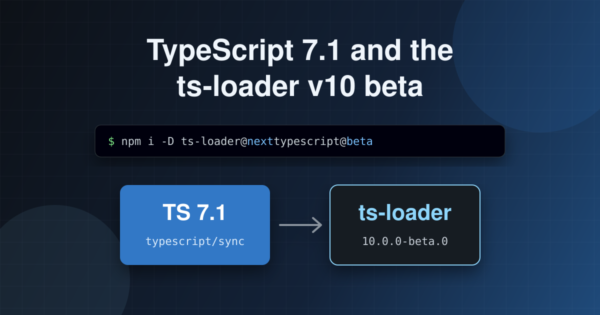
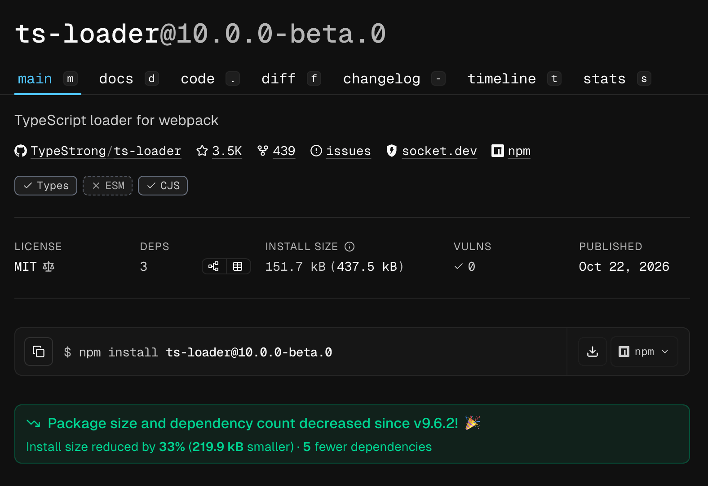

`ts-loader` 10.0.0-beta.0 has shipped. It's a ground-up rewrite of `ts-loader`'s compilation engine, built on the new native API that ships with [TypeScript 7.1](https://devblogs.microsoft.com/typescript/announcing-typescript-7-1-beta/#typescript-7.1-api). This post covers how to install it, how to test it, and, importantly, what _isn't_ in v10 and why.



<!--truncate-->

## How we got here

Back in July I wrote about [migrating `ts-loader` to TypeScript 7.1 with AI](../2026-07-31-ts-loader-go/index.md). To recap: TypeScript 7 is a port of the TypeScript compiler from TypeScript to Go. It's much faster. But the classic JavaScript compiler APIs that `ts-loader` had been built on for over a decade (the `LanguageService`, `Program` and watch APIs) were not ported. Instead, a new API is being built, and TypeScript 7.1 is the first Go-based version of TypeScript to ship with it.

That post ended with the [work in progress pull request](https://github.com/TypeStrong/ts-loader/pull/1704) and a promise: when the API was released, we'd ship a new major version of `ts-loader` that supports it. Well, the [TypeScript 7.1 beta](https://devblogs.microsoft.com/typescript/announcing-typescript-7-1-beta/) has landed, the pull request has been merged, and the beta of `ts-loader` v10 is now on npm.

Along the way, Windows-only test failures led to a little side quest, which I wrote up in [Cross Operating System Test Probes with GitHub Actions](../2026-10-07-cross-operating-system-test-probes-with-github-actions/index.md).

## What's in v10?

With v10, `ts-loader` now compiles exclusively through TypeScript's native `typescript/sync` API. The legacy compiler API integration is **gone**! There is no "use the old API if it's there, the new one otherwise" mode. I mentioned in the previous post that AI loves backwards compatibility; the first attempt at the port tried to support both APIs, and it was much more complicated as a result. Supporting only the new API keeps the codebase much simpler.

That brings with it some baseline changes:

- **TypeScript 7.1+ is required** (up from 3.6.3+). Until TypeScript 7.1 has a stable release, that means the 7.1 beta or later.
- **Node.js 22+ is required** (up from 12+). Node 12 has been end-of-life for a long time.
- **webpack 4 and 5 are both still supported.**
- **`chalk` has been replaced with [`picocolors`](https://github.com/alexeyraspopov/picocolors)**, which slims down `ts-loader`'s dependencies.

In fact I rather enjoyed decreasing `ts-loader`'s dependencies as part of this work. And check it out, [npmx shows that it is so](https://npmx.dev/package/ts-loader/v/10.0.0-beta.0)!



## Installing the beta

v10 is published under the `next` dist-tag on npm (confusingly I didn't publish it under the `beta` tag - sorry). The `latest` tag still points at v9 (currently 9.6.2), so a plain `npm install ts-loader` will keep giving you the version that works with the classic TypeScript API. To try v10, you need to ask for it explicitly, along with the TypeScript 7.1 beta:

```bash
npm install ts-loader@next typescript@beta --save-dev
```

Or with pnpm: (other package managers are available)

```bash
pnpm add -D ts-loader@next typescript@beta
```

If you want to live on the edge, `typescript@next` will give you the latest TypeScript nightly. The `ts-loader` test suite runs against both a pinned TypeScript 7.1 build and `typescript@next`, so nightlies should work too.

### A minimal setup

Your webpack config probably doesn't need to change at all, unless you're using one of the removed options (see below). Here's the webpack config from the [`examples/simple`](https://github.com/TypeStrong/ts-loader/tree/next/examples/simple) project in the `ts-loader` repo:

```js
import HtmlWebpackPlugin from 'html-webpack-plugin';

/** @type {import('webpack').Configuration} */
export default {
  entry: './src/index.ts',
  module: {
    rules: [{ test: /\.ts$/, loader: 'ts-loader' }],
  },
  resolve: {
    extensions: ['.ts', '...'],
  },
  plugins: [new HtmlWebpackPlugin()],
};
```

That's it. `ts-loader` will find your `tsconfig.json` and compile through TypeScript 7.1.

## Testing the beta

This is a beta, and I'd really like people to try it before we go stable. The test suite is extensive, but it's not your codebase. Here's what I'd suggest:

1. **Create a branch** in a project that uses `ts-loader` and install `ts-loader@next` and `typescript@beta` as above.
2. **Check your loader options** against the list of removed and unsupported features below. If you use any of them, you'll need to move that config elsewhere, or you'll find out that v10 isn't for you yet.
3. **Run a production build** (`webpack --mode production`) and compare the output to what you got with v9. It should be functionally the same.
4. **Run your dev workflow** - `webpack --watch` or `webpack serve` - and make a few changes. Check that rebuilds happen, that type errors show up when you introduce them, and that they go away when you fix them.
5. **Deliberately break something**: add a type error and check it's reported in the webpack output as you'd expect.
6. **Try `transpileOnly: true`** if that's what you normally use.

If something doesn't work, please [raise an issue](https://github.com/TypeStrong/ts-loader/issues) with a minimal reproduction. Better yet, write a test and submit it in a PR!

One thing to watch out for: if you pair `ts-loader` with [`fork-ts-checker-webpack-plugin`](https://github.com/TypeStrong/fork-ts-checker-webpack-plugin), that plugin may not support TypeScript 7 yet. Check its documentation before relying on it alongside `ts-loader` v10.

## What isn't in v10, and why

This is the section I suspect most people will care about. When I started the port, one of my principles was that I reserved the right not to port everything. The codebase is more than ten years old, and features had accreted over that time. Some of them had outlived their usefulness, and some of them simply can't be built on the new API. Here's the list.

By the way, I could be wrong about some of this. If I am, tell me; I want to know.

### Removed: `compilerOptions`

The `compilerOptions` loader option let you override the compiler options in your `tsconfig.json` on a per-loader basis. The native API resolves a project's compiler options purely from its on-disk `tsconfig.json`, and there's no hook to override them for a particular loader instance.

**What to do instead:** move those options into your `tsconfig.json`. If you were using `compilerOptions` so that different loader rules could compile with different settings, create a separate `tsconfig` for each and point each rule at the right one using the `configFile` option:

```js
{
  test: /\.ts$/,
  loader: 'ts-loader',
  options: {
    configFile: 'tsconfig.app.json',
  },
}
```

### Removed: `context`

The `context` option let you resolve the paths in a `tsconfig.json` relative to a different directory than the one the config file was in. That was handy if your `tsconfig.json` lived outside your project root. The native API always resolves relative paths against the config file's own directory, and doesn't expose a way to change the base path.

**What to do instead:** put a `tsconfig.json` in the place your paths should be relative to. If you want to share settings, a small `tsconfig.json` that `extends` the shared one works nicely.

### Removed: `happyPackMode`

`happyPackMode` existed to make `ts-loader` play nicely with [HappyPack](https://github.com/amireh/happypack) and [`thread-loader`](https://github.com/webpack/thread-loader), which parallelise loaders across multiple processes. HappyPack is archived and no longer maintained, there's no point supporting it.

### Removed: `experimentalFileCaching`

This option enabled a file cache `ts-loader` maintained on top of TypeScript's classic compiler host. With the native API, file reading and caching happen inside TypeScript itself, using its own caching model. There's nothing for `ts-loader` to plug into, and nothing for this option to do.

### Removed: `experimentalWatchApi`

`experimentalWatchApi` let `ts-loader` use TypeScript's classic watch API rather than its own incremental `LanguageService` approach. The classic watch API is gone in TypeScript 7, and the native API supersedes it.

### Removed: `onlyCompileBundledFiles`

By default `ts-loader` follows TypeScript's behaviour and considers all the files included by your `tsconfig.json`, not just the ones webpack bundles. `onlyCompileBundledFiles` restricted that to only the files webpack actually pulled in. The native API always resolves a project's root files from its `tsconfig.json`, and provides no hook to restrict them to what webpack bundles.

**What to do instead:** use `include`, `exclude` or `files` in your `tsconfig.json` to tell TypeScript which files are part of your project. A dedicated `tsconfig` for your webpack build (via `configFile`) is a good way of keeping that separate from what your editor sees.

### Removed: `ttypescript` and other classic-API compilers

The `compiler` option still exists, but it must now resolve to a package that exposes a `<compiler>/sync` entry point; which is to say, TypeScript's native API. That means you can still use a TypeScript prerelease installed under an alias, but drop-in replacements for the classic compiler API, such as [`ttypescript`](https://github.com/cevek/ttypescript), are no longer supported. They patched the classic API, and the classic API isn't there any more.

I'm pondering removing this before going live as I'm not sure this is a feature that is used.

### Changed: info logging goes to stderr

This isn't a removal, but it might surprise you. `ts-loader`'s info-level log messages are now written to stderr by default, which is what the documentation always said would happen. Previously they always went to stdout regardless of `logInfoToStdOut`. If you want them on stdout, set `logInfoToStdOut: true`.

Mind you, `ts-loader` does very little logging; most of the logging happens through webpack itself. So this isn't that significant a change.

### Changed: `errorFormatter`'s `colors` argument

If you provide a custom `errorFormatter`, the `colors` argument it receives is now a small `picocolors`-backed helper object rather than a `chalk` instance. If your formatter calls simple colour functions like `colors.red(...)`, you'll probably be fine. If it uses chalk-specific features like chaining (`colors.bold.red(...)`), you'll need to adjust it.

## Accepted, but not supported (yet)

Some options are still accepted by v10, so your config won't blow up, but they currently don't do anything. These are features where the native API doesn't yet offer what we need, or where it's not clear the feature is worth building. If the API grows support, they may come back to life; if not, they'll probably be removed before releasing 10 proper.

### `getCustomTransformers`

Custom transformers let you hook into TypeScript's emit and rewrite the output. The native API doesn't expose equivalent extension points for custom transformers. It's possible it will in future, so the option has been left in place for now, but it does nothing.

### `resolveModuleName` and `resolveTypeReferenceDirective`

These options let you supply your own module resolution, and existed to support things like [Yarn Plug'n'Play](https://yarnpkg.com/features/pnp). The native API does have [support for custom resolvers](https://github.com/microsoft/TypeScript/pull/64299), so this one _could_ be implemented. However, it's not clear that this is a feature many `ts-loader` users actually use, so it hasn't been implemented for now. If you rely on it, please [let us know](https://github.com/TypeStrong/ts-loader/issues); that's exactly the sort of feedback the beta is for.

### `projectReferences`

[Project references](https://www.typescriptlang.org/docs/handbook/project-references.html) in your `tsconfig.json` are followed by the native API, so code in referenced projects is resolved. But the `projectReferences` loader option, which made `ts-loader` incrementally build upstream projects to disk the way `tsc --build` does, has no effect. v10 doesn't build referenced projects to disk.

**What to do instead:** if you need referenced projects built, run `tsc --build` as a separate step before webpack.

## When will v10 be stable?

Not before TypeScript 7.1 itself has a stable release. Once it does, and once the beta has had some real-world use, `ts-loader` v10 will move to `latest` on npm. Until then, v9 remains the stable release, and remains the version to use with TypeScript 6 and earlier.

So please, give the beta a go and tell us how you get on. The [CHANGELOG](https://github.com/TypeStrong/ts-loader/blob/next/CHANGELOG.md) has the full list of changes, and [issues](https://github.com/TypeStrong/ts-loader/issues) are where feedback goes.
